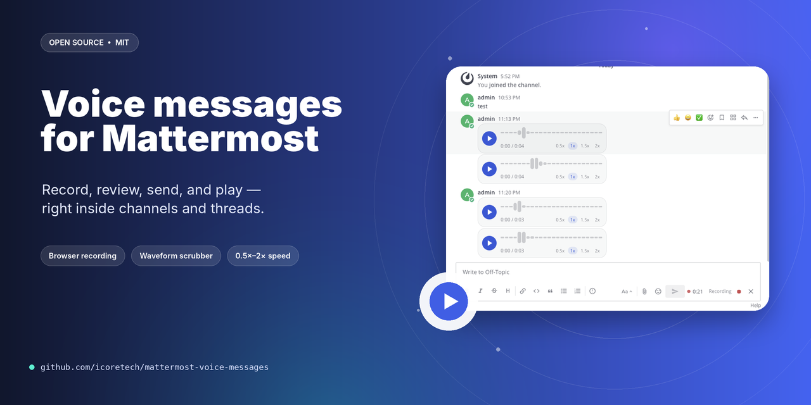

# Mattermost Voice Messages

**WhatsApp-style voice messages for Mattermost channels and threads**

[](https://github.com/icoretech/mattermost-voice-messages/actions/workflows/ci.yml)
[](https://github.com/icoretech/mattermost-voice-messages/actions/workflows/release.yml)
[](https://github.com/icoretech/mattermost-voice-messages/releases/latest)
[](LICENSE)

The plugin adds a microphone button to Mattermost web and desktop. Users can record a short audio message, listen to it before sending, and post it in a channel or thread.

People reading from Mattermost web, desktop, or a mobile browser get the full voice-message player with waveform and speed controls. People reading from the native Mattermost iOS or Android apps get a regular audio attachment they can play with the mobile app's built-in audio player.

<p align="center">
  
</p>

## Features

- Record and send voice messages from Mattermost web and desktop
- Review recordings with waveform playback before sending
- Send voice messages in channels and threads
- Play messages inline on web, desktop, and mobile browser
- Change playback speed: `0.5x`, `1x`, `1.5x`, and `2x`
- Keep received voice messages playable in the native Mattermost mobile apps
- Show the web player for matching audio files uploaded outside the recorder
- Respect existing Mattermost posting and file-upload permissions
- Optional local browser transcription before sending; no server-side speech-to-text, text-to-speech, or audio processing

## Requirements

- Mattermost Server meeting the minimum version specified in the [plugin manifest](plugin.json)
- File uploads enabled in Mattermost
- Users need permission to post messages and upload files in the target channel
- A modern browser with microphone access for recording
- For client transcription only: a browser compatible with browser-whisper, WebCodecs/WebGPU, or the browser-whisper WASM fallback
- For client transcription only: first-use network access so the browser can download WASM/model weights
- For client transcription only: Mattermost served with `Cross-Origin-Opener-Policy: same-origin` and `Cross-Origin-Embedder-Policy: require-corp` when local transcription is enabled

The record button is available in Mattermost web, desktop, and mobile browser. Native Mattermost iOS and Android users can listen to received voice messages as audio attachments, but they do not get the plugin's record button.

Recording size and duration limits are configurable in System Console. The voice upload endpoint always respects Mattermost's maximum file size, even when the plugin's size setting is higher. Supported audio formats are WebM, Ogg, MP4/M4A, MP3, and WAV.

## Installation

Download the latest plugin bundle from the [Releases](https://github.com/icoretech/mattermost-voice-messages/releases) page and upload the `.tar.gz` file through **System Console > Plugin Management**.

After uploading, enable **Mattermost Voice Messages** from the plugin list.

### Signature verification

Releases include a detached GPG signature (`.tar.gz.sig`). To verify:

```bash
# Import the public key
curl -sL https://raw.githubusercontent.com/icoretech/mattermost-voice-messages/main/assets/signing-key.asc | gpg --import

# Verify the bundle
gpg --verify ch.icorete.mattermost-voice-messages-*.tar.gz.sig ch.icorete.mattermost-voice-messages-*.tar.gz
```

To add the key to your Mattermost server for automatic plugin signature verification:

```bash
mmctl plugin add key assets/signing-key.asc
```

## Usage

1. Open a channel or thread in Mattermost.
2. Click the microphone button next to the composer.
3. Allow microphone access if the browser asks.
4. Stop recording when finished.
5. Review the clip using playback and the waveform to move through the recording.
6. If client transcription is enabled, click **Transcribe locally** in the review panel, or wait for transcription to start automatically when the admin has enabled auto-start.
7. Wait for transcription to finish, then edit or clear the generated text. **Send** is disabled while transcription runs. The transcript is sent as the normal Mattermost message text; if cleared, the voice post is sent without message text.
8. Click **Send**, or use **Cancel** next to it to discard the recording.

To stop transcription without discarding the recording, use **Cancel** beside the transcription status. If no speech is recognized, click **Try again** or send the audio without a transcript.

The recorder shows the active limits and stops automatically at the duration limit or near the file size limit, leaving room for the browser to finish encoding. The review panel explains why recording stopped. If delayed browser data still pushes a recording over the size limit, download it before discarding it; sending and transcription stay disabled while it exceeds the current limits.

On web, desktop, and mobile browser, sent voice messages show the custom voice player. On native Mattermost mobile apps, they show as regular audio attachments. If a transcript was sent, it appears as normal post text above the attachment.

## Configuration

Configure the plugin from **System Console > Plugins > Mattermost Voice Messages**.

| Setting | Default | Effect |
| --- | --- | --- |
| `EnableVoiceMessages` | `true` | Shows the microphone recorder and allows voice-message uploads. When disabled, the recorder is hidden and direct upload API calls return `403`. |
| `MaxVoiceMessageSizeMB` | `25` | Maximum voice recording upload size in MiB. Set `0` to use Mattermost's maximum file size. A positive value can restrict, but never increase, the Mattermost limit. |
| `MaxRecordingDurationSeconds` | `21600` | Maximum recording duration in seconds. Set `0` to disable the duration limit; the file size limit still applies. |
| `EnableUploadedAudioPreview` | `true` | Uses the voice-message player for supported audio files uploaded outside the recorder. Existing voice-message posts still render normally. |
| `EnableClientTranscription` | `false` | Allows users to transcribe reviewed voice messages locally in the browser before sending. Requires browser-whisper model downloads on first use and cross-origin isolation headers on the Mattermost site. |
| `ClientTranscriptionAutoStart` | `false` | Starts local transcription automatically after recording stops when client transcription is enabled. When disabled, users click **Transcribe locally** in the review panel. |
| `ClientTranscriptionModel` | `whisper-tiny` | Selects the browser-whisper model to run in the browser. `whisper-tiny` is the multilingual default. `parakeet-tdt-0.6b-v3` supports 25 languages with automatic detection and requires WebGPU; q8 is recommended (~670 MB). `parakeet-ctc-0.6b` is English-only (~612 MB with q8), without punctuation or timestamps. |
| `ClientTranscriptionQuantization` | `hybrid` | Selects the model precision passed to browser-whisper. Use `hybrid` for the default Whisper models. Parakeet TDT accepts `hybrid`/`fp16`, `q8`, or `fp32`; `q4` is unsupported. Parakeet CTC accepts `hybrid` (mapped to q8), `q8`, or `fp32`; `q4` and `fp16` are unsupported. |
| `ClientTranscriptionLanguage` | empty | Optional BCP-47 language tag passed to browser-whisper, for example `en` or `it`. Leave empty for auto-detect. Models without language support ignore this value. |

The recorder refreshes these limits before recording, transcription, and sending. If an admin raises a limit while a recording is blocked, use **Check current limits** in the review panel to try again with the same audio. The server checks the current effective size limit on every upload. Duration limits control recording time; the upload endpoint validates the duration reported by the recorder and does not decode files to measure their duration. Ordinary Mattermost file attachments follow Mattermost's upload rules, independently of the recorder's duration setting.

Recording, waveform preparation, and local transcription use browser memory. Raising upload limits does not guarantee that a device can process recordings of that size locally.

`parakeet-tdt-0.6b-v3` is an optional NVIDIA model with automatic recognition of 25 languages, punctuation, and word timestamps. It requires WebGPU and has no WASM fallback. Use `q8` for a download of about 670 MB. `hybrid` uses the fp16 encoder, just like `fp16`; both need the GPU's `shader-f16` capability and download about 1.26 GB. `fp32` needs about 2.4 GB and can fail at the browser's allocation limits. The model ignores the language setting; `q4` is rejected.

`parakeet-ctc-0.6b` remains available for English audio. Its q8-backed download is about 612 MB; `fp32` is about 2.4 GB. It ignores the language setting and does not provide punctuation or timestamps. The plugin rejects `q4` and `fp16` because those precisions can produce empty text.

Both [Parakeet TDT 0.6B v3](https://huggingface.co/nvidia/parakeet-tdt-0.6b-v3) and [Parakeet CTC 0.6B](https://huggingface.co/nvidia/parakeet-ctc-0.6b) are by NVIDIA and licensed under [CC BY 4.0](https://creativecommons.org/licenses/by/4.0/). The TDT weights were converted to ONNX with int8 quantization by [istupakov](https://huggingface.co/istupakov/parakeet-tdt-0.6b-v3-onnx), with fp16 export and cast fixes by [ysdede](https://huggingface.co/ysdede/parakeet-tdt-0.6b-v3-onnx). The CTC weights were converted to ONNX and quantized by [onnx-community](https://huggingface.co/onnx-community/parakeet-ctc-0.6b-ONNX). Model weights download directly to the browser; the plugin does not modify or bundle them.

browser-whisper 2 removes `whisper-large-v3`. Existing saved settings load as `whisper-large-v3-turbo`; legacy `hybrid` (including the default) and `fp32` precision become `q4`, while `q4`, `q8`, and `fp16` are preserved. This migration applies only to the retired model, leaves other settings unchanged, and logs the effective replacement when loaded. Save the replacement model and precision in System Console to update the stored settings.

Access is inherited from Mattermost permissions:

- Users must be authenticated.
- Users must be members of the target channel.
- Users must have permission to create posts in the channel.
- Users must have permission to upload files in the channel.

## Development

Install build dependencies:

```bash
cd webapp
npm ci
```

Use the Go version declared in [`go.mod`](go.mod) and the Node.js version configured in the [CI workflow](.github/workflows/ci.yml).

Build the plugin bundle:

```bash
make dist
```

The bundle is written to:

```text
dist/ch.icorete.mattermost-voice-messages-<version>.tar.gz
```

### Local Mattermost preview stack

A Docker Compose development stack is included:

```bash
docker compose -f docker-compose.dev.yml up -d
```

By default it serves Mattermost through a local nginx proxy at:

```text
http://localhost:18065
```

The proxy adds the browser isolation headers required by local client transcription:

```text
Cross-Origin-Opener-Policy: same-origin
Cross-Origin-Embedder-Policy: require-corp
```

It also relaxes the local preview Content Security Policy enough for
browser-whisper workers, WASM backend modules, and Parakeet TDT runtime imports
from jsDelivr:

```text
worker-src 'self' blob:
child-src 'self' blob:
script-src 'self' 'wasm-unsafe-eval' blob: https://cdn.jsdelivr.net
script-src-elem 'self' 'wasm-unsafe-eval' blob: https://cdn.jsdelivr.net
```

The Mattermost container is only exposed inside the Compose network. Change
the public preview port with `MATTERMOST_DEV_PORT`, and change the Site URL
with `MATTERMOST_DEV_SITE_URL` if you bind the proxy to another hostname.

For a hosted server, apply these requirements before enabling client
transcription. Check both the HTTP CSP header and Mattermost's HTML CSP meta
tag: either can block workers or WASM. Scope any CSP rewrite to the application
HTML and preserve the existing policies on attachments and API responses.
With `Cross-Origin-Embedder-Policy: require-corp`, enable Mattermost's local
image proxy to keep public external images available, and test any integrations
that depend on authenticated external images or popup windows. Confirm
`crossOriginIsolated` is `true` in the browser and transcribe spoken audio;
upload and playback checks alone do not verify model inference.

Deploy to a running local or remote Mattermost server with:

```bash
MM_SERVICESETTINGS_SITEURL=http://localhost:18065 \
MM_ADMIN_USERNAME=admin@example.com \
MM_ADMIN_PASSWORD='password' \
make deploy
```

`make deploy` builds the plugin, uploads the bundle through the Mattermost API,
and enables it.

Personal access token authentication is also supported:

```bash
MM_SERVICESETTINGS_SITEURL=https://mattermost.example.com \
MM_ADMIN_TOKEN='personal-access-token' \
make deploy
```

## Quality gates

Run the same checks used by CI:

```bash
make apply
make manifest-check
go fix -diff ./build/... ./server/...
go vet ./build/... ./server/...
go test -race ./build/... ./server/...
npm --prefix webapp run typecheck
npm --prefix webapp run biome:ci
npm --prefix webapp run react-doctor
npm --prefix webapp run test
npm --prefix webapp run build
make dist
```

`npm --prefix webapp run lint` runs Biome in write mode, TypeScript type
checking, and React Doctor.

## Release

Releases are managed with release-please. The release workflow builds the
Mattermost plugin bundle, signs it with the configured organization GPG secret,
and uploads both the bundle and detached signature to the GitHub release.

## Security

Please report vulnerabilities through GitHub Security Advisories. If advisories
are unavailable, open a minimal issue without sensitive details so maintainers
can arrange a private channel.

Voice audio is uploaded to Mattermost only when the user sends the voice message.
Local transcription runs in the browser before send and does not send audio to
the plugin server for transcription. browser-whisper downloads model assets from
upstream locations on first use.

## License

[MIT](LICENSE) - iCoreTech, Inc.
